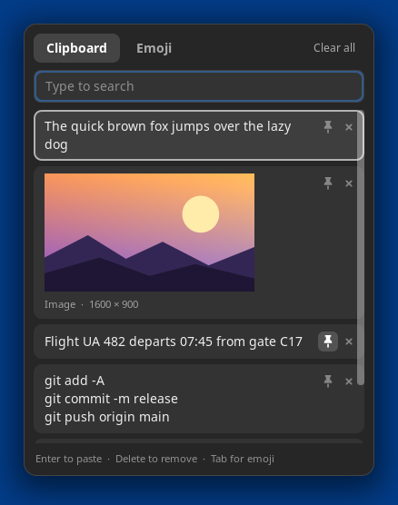
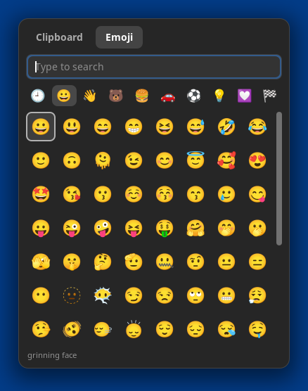
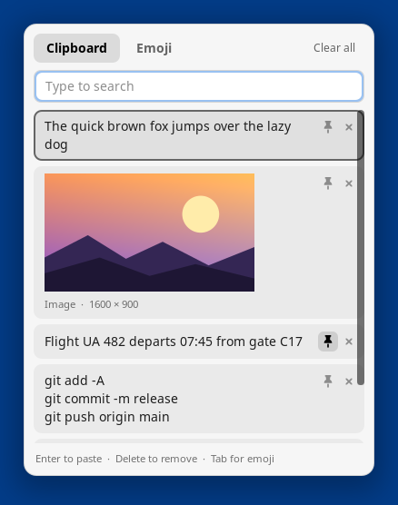
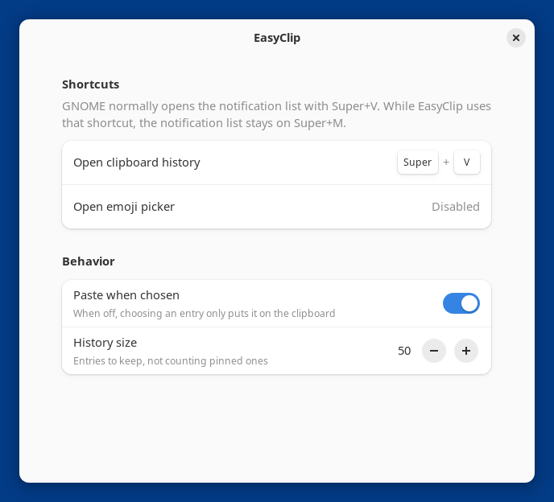

# EasyClip

Clipboard history and an emoji picker for GNOME, on <kbd>Super</kbd>+<kbd>V</kbd>.

EasyClip is a GNOME Shell extension. It remembers the text and images you copy,
shows them in a small popup next to your cursor, and pastes the one you pick
straight into the window you were working in.

| Clipboard | Emoji | Light mode |
| :---: | :---: | :---: |
|  |  |  |

## Features

- **Text and image history** that survives logging out and restarting.
- **Search as you type**, pin entries you want to keep, remove the ones you don't.
- **Emoji picker** with search, categories and a recently-used list.
- **Pastes for you**: picking an entry types the paste shortcut into the focused
  window (<kbd>Ctrl</kbd>+<kbd>Shift</kbd>+<kbd>V</kbd> in terminals). This can be turned off.
- **Stays out of the way**: the popup takes no input grab, so touchpad gestures,
  workspace switching and your other shortcuts keep working while it is open.
- **Follows light and dark mode.**
- **Local only**: nothing leaves your computer, and copies that a password
  manager marks as secret are not recorded.

## Requirements

- GNOME Shell **46** (Ubuntu 24.04 LTS).
- Developed and tested on Wayland.

Other GNOME versions are not supported yet; see [Roadmap](#roadmap).

## Install

### Ubuntu 24.04: the .deb

1. Download `gnome-shell-extension-easyclip_<version>_all.deb` from the
   [latest release](https://github.com/Brainiac11/EasyClip/releases/latest).
2. Install it:

   ```sh
   sudo apt install ./gnome-shell-extension-easyclip_*_all.deb
   ```

3. **Log out and back in.** GNOME on Wayland only notices newly installed
   extensions when the session starts.
4. Turn it on, either in the **Extensions** app or with:

   ```sh
   gnome-extensions enable easyclip@brainiac11.github.io
   ```

### Without root: the zip

Download `easyclip@brainiac11.github.io.shell-extension.zip` from the same
release page, then:

```sh
gnome-extensions install --force easyclip@brainiac11.github.io.shell-extension.zip
```

Log out and back in, and enable it as in step 4 above.

### From source

```sh
git clone https://github.com/Brainiac11/EasyClip.git
cd EasyClip
make install
```

This installs for your user only. Log out and back in, then enable it.

## Using it

| Key | What it does |
| --- | --- |
| <kbd>Super</kbd>+<kbd>V</kbd> | Open or close the popup |
| Type | Search the history, or the emoji |
| <kbd>↑</kbd> <kbd>↓</kbd> <kbd>Page Up</kbd> <kbd>Page Down</kbd> | Move through the list (<kbd>←</kbd> <kbd>→</kbd> too, in the emoji grid) |
| <kbd>Enter</kbd> | Paste the selected entry |
| <kbd>Tab</kbd> | Switch between Clipboard and Emoji |
| <kbd>Delete</kbd> | Remove the selected entry (when the search box is empty) |
| <kbd>Esc</kbd> | Close |

With the mouse: click an entry to paste it, the pin to keep it, the cross to
remove it. **Clear all** removes everything that is not pinned. Clicking
anywhere outside the popup closes it.

## Settings

Open them from the **Extensions** app, or with:

```sh
gnome-extensions prefs easyclip@brainiac11.github.io
```



- **Shortcuts** for the clipboard and the emoji tab. Click a row and press the
  new combination.
- **Paste when chosen**: when off, picking an entry only puts it on the clipboard.
- **History size**: how many entries to keep (5 to 500), not counting pinned ones.

### About Super+V

GNOME itself uses <kbd>Super</kbd>+<kbd>V</kbd> to open the notification list.
While EasyClip is enabled and using that shortcut, it takes it over; the
notification list stays available on <kbd>Super</kbd>+<kbd>M</kbd>. When you
disable EasyClip, or give it a different shortcut, GNOME gets
<kbd>Super</kbd>+<kbd>V</kbd> back.

## Privacy

- EasyClip never uses the network.
- The history is stored **unencrypted** in `~/.cache/easyclip/`, in files only
  your user account can read.
- Copies carrying the `x-kde-passwordManagerHint` marker, which password managers
  such as KeePassXC set, are not recorded. A password copied from an app that
  does not set this marker **will** be recorded like any other text; remove it
  with <kbd>Delete</kbd> or **Clear all**.
- Text over 1 MB and images over 24 MB or 40 megapixels are ignored.
- To erase everything: disable the extension, then `rm -rf ~/.cache/easyclip`.

## Uninstall

```sh
gnome-extensions disable easyclip@brainiac11.github.io

sudo apt remove gnome-shell-extension-easyclip             # if installed from the .deb
gnome-extensions uninstall easyclip@brainiac11.github.io   # if installed from the zip or from source

rm -rf ~/.cache/easyclip                                   # the stored history
```

## Troubleshooting

**Super+V still opens the notification list.** The extension is not running.
Check with `gnome-extensions info easyclip@brainiac11.github.io`; it should say
`State: ACTIVE`. If it is not listed at all, log out and back in.

**Picking an entry does not paste.** A few applications use a different paste
shortcut. Turn off *Paste when chosen* and paste by hand, and please open an
issue naming the application.

**Something else.** Errors are logged by GNOME Shell:

```sh
journalctl --user -b -o cat /usr/bin/gnome-shell | grep -i -B2 -A8 easyclip
```

Please include that output when you
[report a problem](https://github.com/Brainiac11/EasyClip/issues).

## Building

Needs `make`, `zip`, `dpkg-deb`, `python3` and `glib-compile-schemas`
(package `libglib2.0-bin`), all of which a normal Ubuntu desktop already has.

| Command | Result |
| --- | --- |
| `make check` | Validate the JSON files and the settings schema |
| `make zip` | `build/easyclip@brainiac11.github.io.shell-extension.zip` |
| `make deb` | `build/gnome-shell-extension-easyclip_<version>_all.deb` |
| `make dist` | Both, plus `build/SHA256SUMS` |
| `make install` / `make uninstall` | Install for the current user, or remove it again |

The version number lives in `src/metadata.json` (`version-name`) and nowhere
else. [RELEASING.md](RELEASING.md) describes how a release is made.

The emoji table in `src/emoji.json` is generated by
[`tools/gen_emoji.py`](tools/gen_emoji.py) from Unicode's `emoji-test.txt` and
the English CLDR annotations.

## Roadmap

- Support for GNOME 47 and later (Ubuntu 24.10 onwards, Fedora, Debian 13).
- A listing on [extensions.gnome.org](https://extensions.gnome.org/).
- Translations: the interface strings are already marked for translation.

## License

EasyClip is free software under the
[GNU General Public License, version 2 or later](LICENSE).

`src/emoji.json` is derived from Unicode data files and is covered by the
[Unicode License V3](LICENSES/Unicode-3.0.txt).
